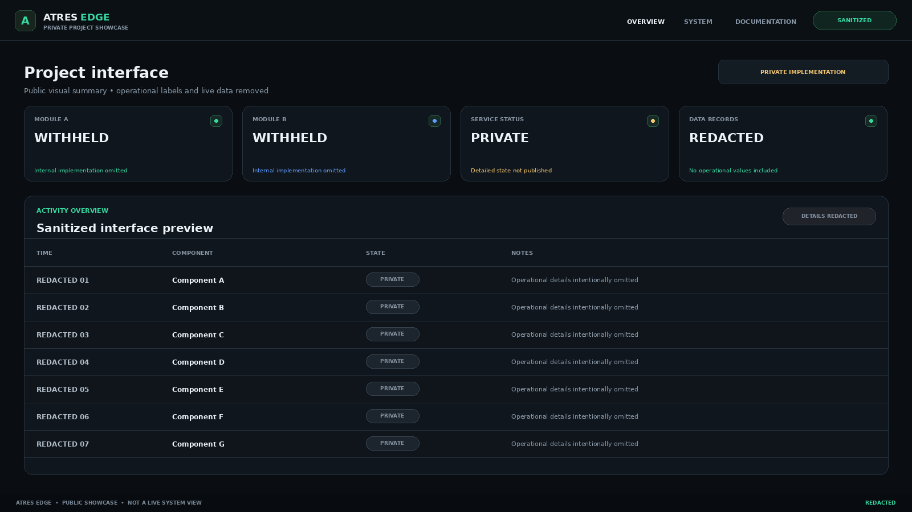
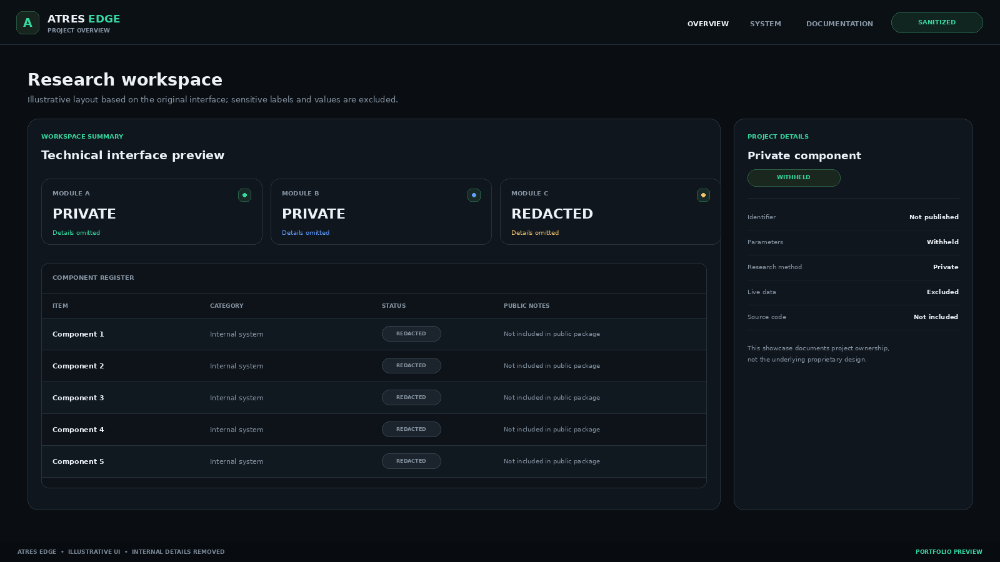

# ATRES Edge Engine — Project Showcase

> A public portfolio summary of an independently developed technical project. The underlying implementation remains private.

## Recognition

- **Årets gymnasiearbete — JENSEN gymnasium Nacka Strand (2026).**
- **Semifinalist — Unga Forskare (2026).**

These are the recognitions associated with the project. The Unga Forskare distinction is stated as semifinalist, not as a competition win.

## Project overview

ATRES Edge Engine is a privately maintained research-engineering project. I developed an end-to-end system with an internal web interface and supporting software components for data handling, persistent storage, operational monitoring, and traceable workflows.

The project demonstrates practical work across:

- **Software engineering:** building and iterating on a multi-component application.
- **Data infrastructure:** handling persistent application data and repeatable processing workflows.
- **Operations:** running and monitoring services in a Linux environment.
- **Interface development:** presenting system state through a custom dashboard.
- **Engineering discipline:** separating components, investigating failures, and documenting the work.

This is a high-level portfolio description. It intentionally avoids disclosing the original research hypothesis, product concept, proprietary methods, decision logic, scoring rules, thresholds, internal schemas, live data, or deployment details.

## Public scope

This repository exists to document project ownership, engineering scope, and recognition. It is **not** the source repository and does not provide a runnable copy of the private system.

It excludes:

- Source code and proprietary implementation logic.
- Research ideas, hypotheses, algorithms, scores, thresholds, or decision rules.
- Production data, identifiers, logs, database files, and operational records.
- API keys, session cookies, credentials, endpoints, and deployment configuration.
- Performance claims or trading/financial results.

The images in this public package are sanitized illustrative interface previews. They are not live screenshots and contain no production data.

## About this showcase

Prepared as a public-facing companion to the private project so that recruiters, educators, and collaborators can understand the work at a high level without access to confidential implementation details.

**Recognition:** JENSEN gymnasium Nacka Strand, 2026 · Unga Forskare 2026 (semifinalist)
